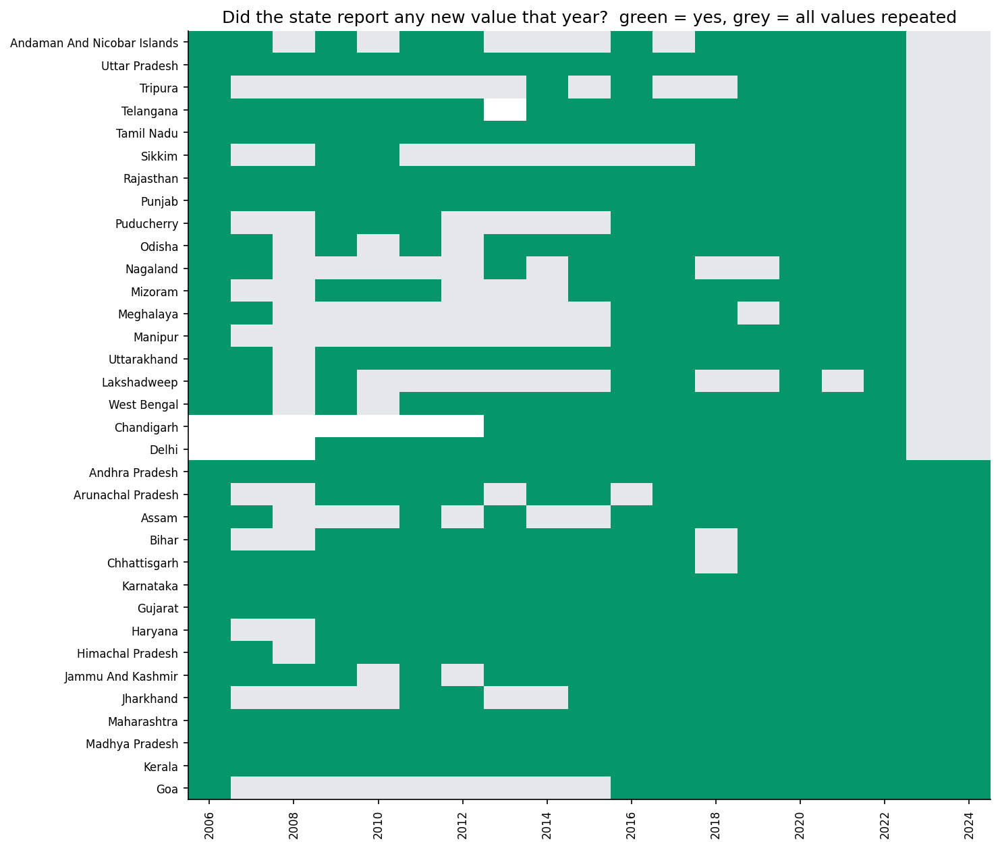
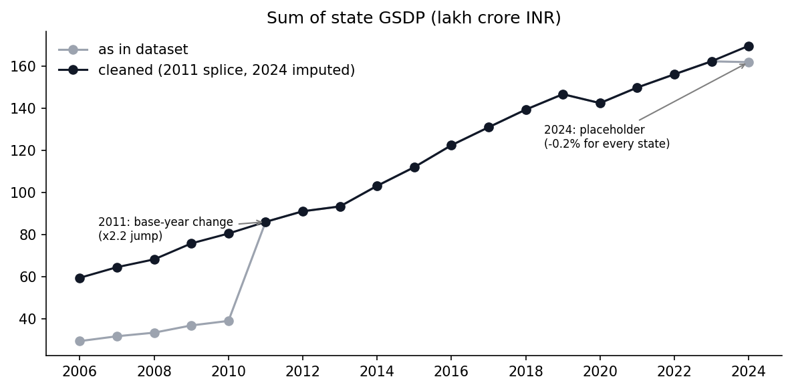
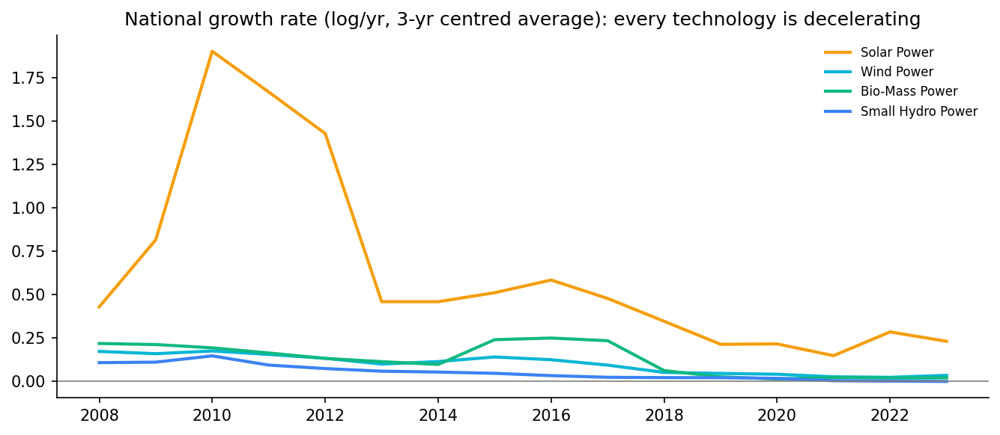
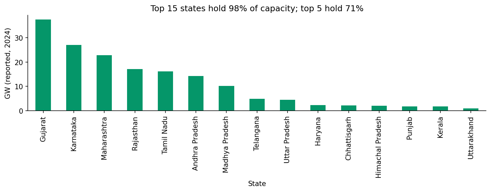
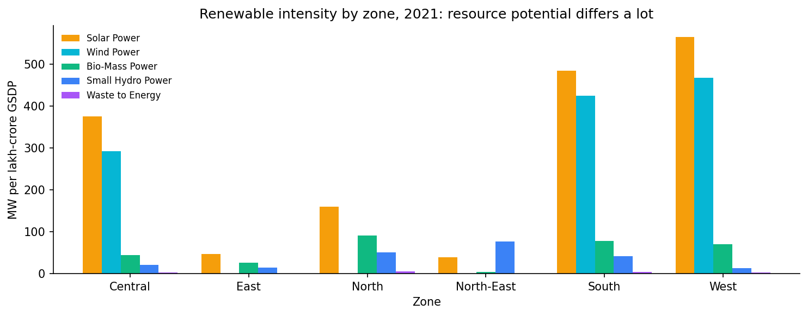
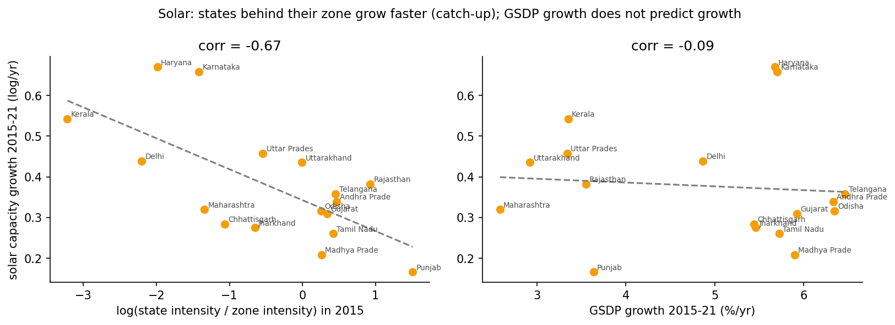
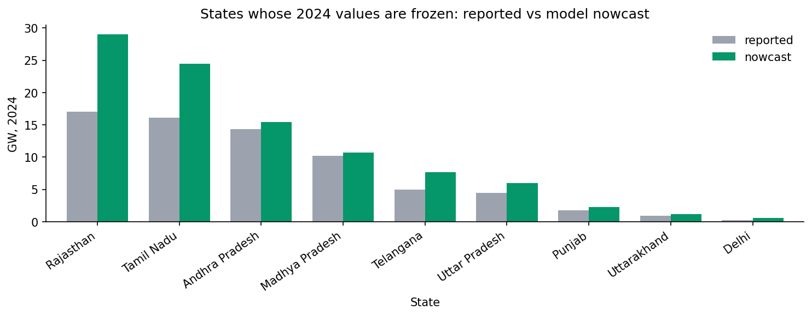
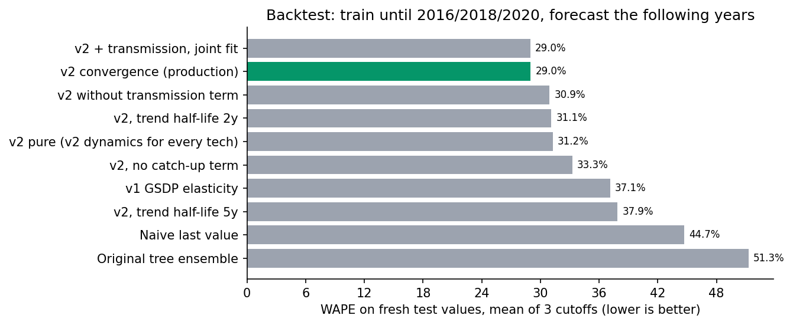
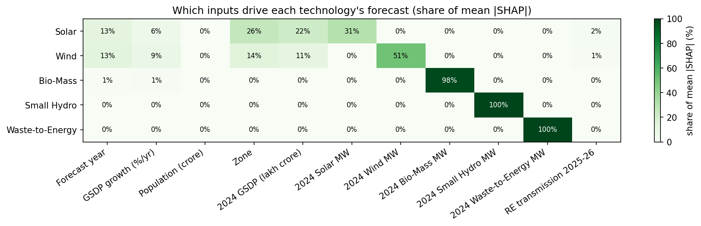
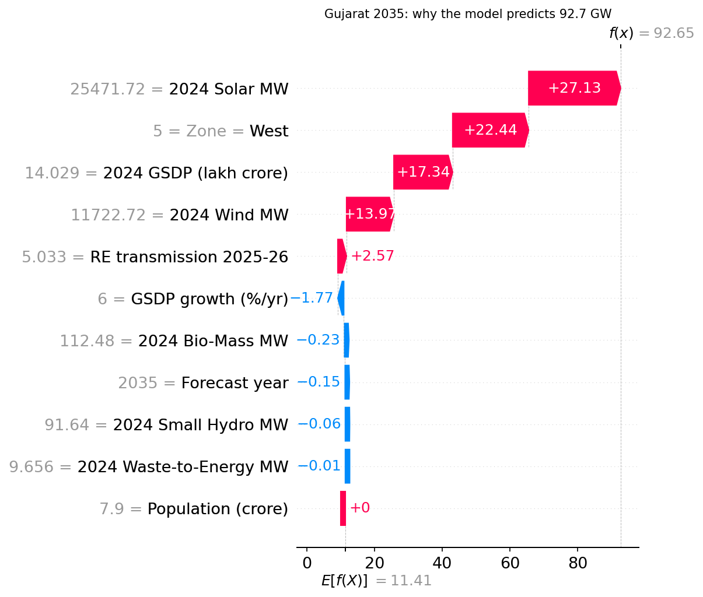

# Renewable Energy 2047: data analysis and model

Dataset: `data/raw/renewable_energy_dataset.csv`, 635 rows covering 34 states/UTs from 2006 to 2024. It has installed MW for 5 technologies, plus Zone, Population and GSDP.

The only outside data used by the model is **renewable-related transmission build-out by state**. It is taken from CEA's yearly transmission reports for FY2018-19 to FY2025-26, published on the National Power Portal (see section 2). The raw files are in `data/external/npp_transmission_raw/`.

To regenerate everything in this folder:

```bash
.venv/bin/python model/external/npp_transmission.py data/external/npp_transmission_raw   # state-year transmission table
.venv/bin/python model/train.py --compare   # backtest + fit -> model/re2047_model.json, model/metrics.json
.venv/bin/python model/eda.py               # charts in reports/eda/
.venv/bin/python model/explain.py           # SHAP + LIME in reports/explainability/
```

The dashboard's API (`backend_api.py`) serves this same v2 model:

- `/api/predict` returns forecasts and financials.
- `/api/explain` returns the exact SHAP breakdown of each forecast, shown in the "Why this forecast?" panel.
- `/api/map` returns each state on its default path, used for map hover.
- `/api/meta` returns the 2024 baselines the input boxes are projected from.

---

## 1. What the data says

### Data quality

| Issue | Evidence | How it's handled |
|---|---|---|
| **Stale repeats.** Values are copied forward instead of re-reported | In 2023–24 only **15 of 34 states** report anything new. The other 19 (including Rajasthan, Tamil Nadu, Telangana and Uttar Pradesh) are frozen at 2022 values. Only 34% of all values are fresh reports. | Only *fresh* values (where the value changed) are used for fitting and scoring. Each state is nowcast from its last fresh report.  |
| **2022 solar gap year** | National solar goes 53.9 → 54.1 → 97.0 GW across 2021–2023, and most states repeat 2021 in 2022 | Growth is measured between consecutive fresh reports, so the 2023 catch-up counts as two years of growth |
| **GSDP base-year break** | Every state jumps about 2.2× in 2011 (2004-05 → 2011-12 base series) | Pre-2011 values rescaled to the new base |
| **2024 GSDP placeholder** | Every state shows −0.2% vs 2023 | Imputed from each state's previous 3-year growth  |
| Small drops | e.g. Bihar solar 390 → 239 MW (2024), Meghalaya hydro → 0 (2022) | Forecasts never decrease. Pairs starting below 10 MW are ignored when fitting |

### Patterns

- **Solar dominates and growth is slowing.** Solar is 64% of 2024 capacity. Every technology's national growth rate is falling: solar went from about 0.5/yr (2013–17) to about 0.2/yr (2019–23). Wind, bio-mass and small hydro are now at 1–6%/yr. 
- **Capacity is highly concentrated.** The top 5 states hold 71% of capacity. 14 states have no wind and 17 have no waste-to-energy. 
- **Zones differ about 14× in intensity.** Intensity is MW per lakh-crore of GSDP. For solar it is 565 in the West vs 40 in the North-East. Wind is zero in the East, North and North-East. 
- **States that are behind catch up, and GSDP growth doesn't predict growth.** Across states, solar growth correlates **−0.67** with intensity relative to the zone, and **−0.09** with GSDP growth. Bio-mass (−0.59) and small hydro (−0.36) also show catch-up. Wind is the exception: it tracks GSDP. 

## 2. How the findings shaped the model

The production model is **v2** ([`model/convergence_model.py`](../model/convergence_model.py)). Each technology's yearly log-growth for a state is modelled as:

```
growth = national trend(year)                                 decelerating; fades with a 3-year half-life after 2024
       + beta  × GSDP growth of the state                     estimated from differences between states
       + kappa × log(zone intensity / state intensity)        catch-up toward zone peers
       + gamma × renewable transmission index(state, year)    solar and wind only; FY2018-19 .. FY2025-26
```

**Transmission term.** CEA's yearly reports list every transmission line completed, with no state column.
- [`model/external/npp_transmission.py`](../model/external/npp_transmission.py) assigns each line to a state from its executing agency (for example GETCO → Gujarat) or place names (for example Bhadla → Rajasthan). That maps 94% of 3,392 projects.
- A line counts as renewable-related if its name or developer points to solar or wind evacuation: pooling stations, solar parks, renewable energy zones, green energy corridor, or renewable developers.
- The index is log(1 + km built in the year), centred across states each year.
- **How it is used:**
  - Up to 2024 it is applied year by year. This sharpens the nowcast for states whose reports are stale; Rajasthan solar moves from 17.8 to 23.4 GW.
  - For 2025–26, each state uses its average for those years.
  - After FY2025-26 there are no reports, so it is 0.
- **How it is fitted:** on the residuals of the model without it ("residual fit"). The trend, GSDP and catch-up effects therefore stay exactly as before. Fitting it jointly backtests the same, but raises the solar GSDP effect from 0.15 to 0.38, which would change the untested long-run path.

- **Bio-mass and small hydro use v1's simpler approach instead.** A GSDP elasticity that fades over time, starting from the last reported value. They barely grow and show little catch-up, and v1 backtests much better for them (see section 3).
- It is fitted with one regression per technology. The year effects are slightly regularised, and the fit uses only fresh-report pairs.
- Each state's forecast starts from its 2024 **nowcast** rather than its frozen reported value.
- Nationally, the nowcast puts 2024 at **197 GW**, against 169 GW reported. 

| Technology | National trend now | GSDP beta | Catch-up kappa | Transmission gamma |
|---|---|---|---|---|
| Solar | +0.235/yr | 0.15 | 0.132 | 0.027 |
| Wind | −0.020/yr | 1.06 | 0.032 | 0.010 |
| Bio-Mass | v1 approach: GSDP elasticity 0.26, fading 25%/yr | | | |
| Small Hydro | v1 approach: GSDP elasticity 0, so held flat | | | |
| Waste-to-Energy | −0.063/yr | 0 | 0 (held flat; sector only appears from 2018) | |

## 3. Backtest

The models are trained up to 2016, 2018 and 2020, then forecast the later years using the actual GSDP. Scoring uses only fresh values, because stale repeats would reward predicting no growth.



| Model | Error on fresh values (%) |
|---|---|
| **v2 convergence (production: transmission term; v1 approach for bio-mass and small hydro)** | **29.0** |
| v2 without the transmission term | 30.9 |
| v2 with v2 approach for every technology, no transmission | 31.2 |
| v2 with trend half-life 2y / 5y | 31.1 / 37.9 |
| v2 without catch-up | 33.3 |
| v1 GSDP elasticity | 37.1 |
| Assume no new capacity | 44.7 |
| Original tree ensemble (`.pkl`) | 51.3 |

By technology (production model): solar 40.0%, wind 10.6%, bio-mass 15.9%, small hydro 8.5%, waste-to-energy 63.2%.

**Transmission term, on recent cutoffs.** It can only be learned once reports exist in the training window (from FY2018-19). At the 2016 and 2018 cutoffs it is therefore inactive, and the whole gain above comes from the 2020 cutoff. A second backtest with cutoffs 2020, 2021 and 2022 isolates it:

| Cutoff | Without transmission | With transmission (production) |
|---|---|---|
| 2020 | 31.8 | 26.0 |
| 2021 | 32.5 | 26.5 |
| 2022 | 41.2 | 35.2 |
| **Mean** | **35.2** | **29.2** |

Solar error on these cutoffs falls from 46.0% to 37.7%.
- **Caveats:**
  - Like GSDP, the backtest uses the transmission actually built in the forecast years.
  - Three versions were tried (renewable line km, renewable substation MVA, all substation MVA). Line km was the only one that clearly helped, so some of the gain comes from choosing the best.
  - The test sets are small (28–84 fresh solar values per cutoff) and overlap. See [`experiments/transmission_backtest.py`](../model/experiments/transmission_backtest.py).

- **The catch-up term is worth about 4 points.**
- **Using v1's approach for bio-mass and small hydro** cuts small hydro error from 16.6% to 8.5% and bio-mass from 18.1% to 15.9%.
  - The total only improves 0.3 points because those two are small in MW. The gain held at every cutoff (2016: 30.9→30.6, 2018: 31.0→30.4, 2020: 31.9→31.8).
  - It was the one simple option tried in [`experiments/hybrid.py`](../model/experiments/hybrid.py) that helped without tuning.
  - **Tried and rejected:**
    - Blending v1 and v2 forecasts made solar worse.
    - Choosing the best model per technology fits the backtest, but when checked on a held-out cutoff it scored *worse* than plain v2 (31.8 vs 31.2). That is overfitting.

**National forecast (GW):** this assumes each state's GSDP keeps growing at its recent rate.

| | 2024 (nowcast) | 2030 | 2035 | 2040 | 2047 |
|---|---|---|---|---|---|
| Solar | 131 | 301 | 361 | 393 | 424 |
| Wind | 50 | 67 | 85 | 109 | 157 |
| Bio-mass + small hydro | 16 | 16 | 16 | 16 | 16 |
| Total | 197 | 384 | 462 | 519 | **597** |

- **The transmission term raises the whole path.** Without it the totals were 189 / 322 / 388 / 437 / 506 GW.
  - The gain comes from a higher starting point: more capacity in the stale states by 2024, and the heavy 2025–26 build-out in Rajasthan (3,451 km) and Gujarat (1,830 km).
  - It persists because later growth is proportional to capacity. Catch-up spreads it: a stronger Rajasthan lifts the West zone's target, so Gujarat 2035 rises too.
- **Bio-mass and small hydro stay roughly flat,** as they have in the data recently.

The biggest uncertainty is how quickly the national trend fades. A 5-year half-life instead of 3 roughly doubles the solar growth still to come by 2047.

### Check against real-time generation (outside data, used only to check)

These numbers are **not** used for fitting.

The National Power Portal publishes all-India generation from MERIT India every few minutes ([dashboard](https://npp.gov.in/dashBoard/gc-map-dashboard-meritchart), endpoint `dashBoard/demandmet2chartdata?date=YYYY-MM-DD`). It gives India-wide totals only, with no state split. The endpoint returned data back to about Nov 2025 and nothing for the 2016–2024 or June 2025 dates tried, so it cannot be used for training.

A peak-output lower bound still gives a rough check on the near-term forecast:

| Day | Peak solar output | Peak wind output |
|---|---|---|
| 15 Dec 2025 | 71.1 GW | 13.6 GW |
| 15 Mar 2026 | 75.3 GW | 11.8 GW |
| 15 May 2026 | 72.9 GW | 14.3 GW |
| 16 Nov 2026 | 86.9 GW | 5.2 GW |
| **Model, 2026 installed** | **214 GW** | **57 GW** |

- **Solar:** installed capacity must be above the highest output seen. The 2026 forecast passes this test, with peak output about 40% of forecast capacity.
  - That ratio is at the low end of plausible: the all-India peak never reaches full capacity, and most rooftop solar doesn't appear in grid data. It hints that the transmission term may push 2026 somewhat high.
  - Without the term the forecast was 172 GW, a ratio of about half.
- **Wind:** output varies too much with the season for a useful check.

## 4. Explainability (SHAP and LIME)

These come from [`model/explain.py`](../model/explain.py). SHAP values are exact (all feature combinations), and per forecast they add up to the prediction to within 4e-13 GW.

- **Globally,** the strongest drivers are the 2024 solar base, zone, state GSDP size, the 2024 wind base and forecast year. GSDP growth comes next. The 2025–26 transmission input is small directly (about 2% of solar's importance), because most of its effect is already in the 2024 base.
- **Population always has zero SHAP,** because the model doesn't use it. This is a good sanity check.
- **By technology:**
  - Solar is split across its existing base (33%), zone (25%) and GSDP size (22%).
  - Wind depends mostly on its own base, plus zone and GSDP.
  - Bio-mass and small hydro depend almost only on their own base, because they now barely grow.
  - Waste-to-energy is 100% its own base, because it is held flat.



**Example: Gujarat 2035, GSDP +6%/yr → 92.7 GW** (71.4 GW without the transmission term).
- **SHAP** explains the gap from the average scenario (11.4 GW): solar base +27.1, zone (West) +22.4, GSDP size +17.3, wind base +14.0, and Gujarat's own 2025–26 transmission +2.6.
- **Why zone grew:** the West zone's target is higher now that Rajasthan's capacity is higher.
- **LIME**, with a local R² of 0.73, says what would move this forecast most from here: zone, then GSDP size, then forecast year.



## 5. Known limitations

- **The data only partly covers 2023–24,** so nowcasts for the 19 frozen states are model estimates, not observations. The transmission term helps, but they are still estimates.
- **The transmission term depends on a heuristic state mapping** from agency and place names, which assigns 94% of projects. It only covers FY2018-19 to FY2025-26.
  - Its effect on 2047 (506 → 597 GW) comes from a higher 2024–26 starting point carried forward, partly through catch-up toward higher zone levels. The backtest can't check that far ahead.
- **The backtest only checks about 4–8 years ahead.** Behaviour out to 2047 depends on the trend half-life, which the backtest selects only weakly.
- **Bio-mass and small hydro are close to flat by design.** Their recent growth is near zero, so the forecast can't anticipate a policy-driven revival. Waste-to-energy is too small and too recent to model, so it is held flat.
- **Single-state forecasts catch up toward a precomputed zone path** that assumes the other states grow at their usual GSDP rate.
