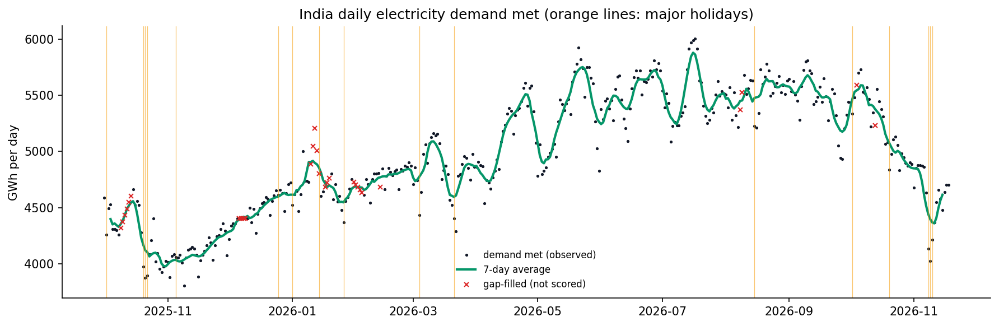
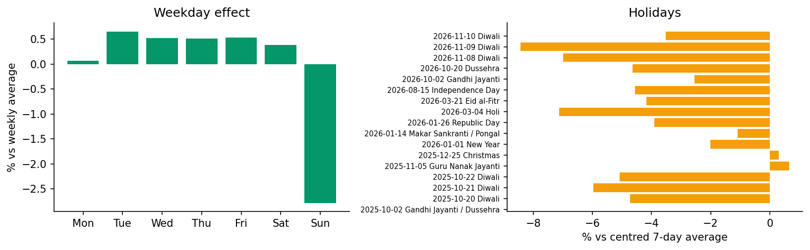
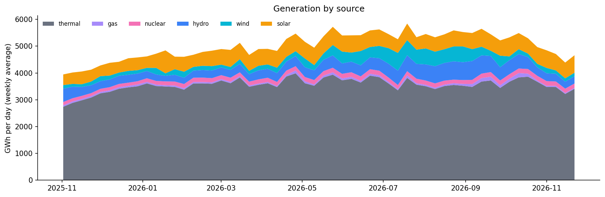
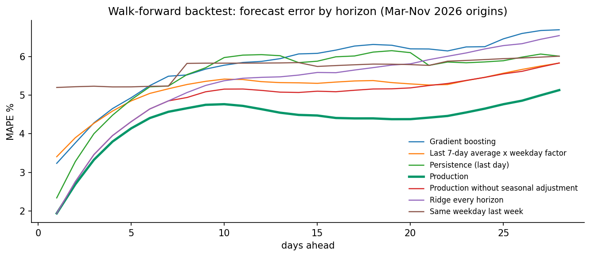
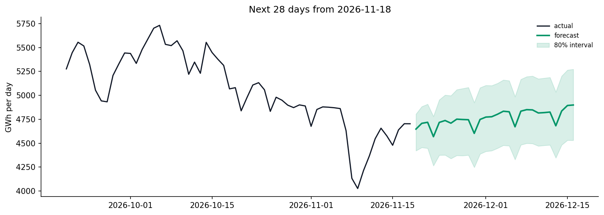

# India daily electricity demand forecast

This is a separate model from the state capacity model in `model/`. It doesn't change that model, its files or the dashboard.

- **What it predicts:** India's daily electricity demand (energy requirement, GWh per day), 1 to 28 days ahead.
- **Data:** `data/raw/india_energy_daily.xlsx`, daily all-India totals built from MERIT India's real-time readings.

To regenerate everything:

```bash
.venv/bin/python demand_forecast/train.py      # backtest + fit + 28-day forecast -> reports/demand/
.venv/bin/python demand_forecast/backtest.py   # backtest only
```

Requires `scikit-learn`, `joblib`, `matplotlib` and `openpyxl`.

**On the website:** the dashboard's **Demand** view (header switch, or `/#demand`) shows this forecast. `train.py` writes `demand_forecast/demand_forecast.json`, and `backend_api.py` serves it at `/api/demand`. The live API only reads that file, so it needs no extra Python packages. After new data arrives, rerun `train.py` and redeploy to refresh the site.

---

## 1. The data

| | |
|---|---|
| Period | 1 Oct 2025 – 18 Nov 2026 (about 13½ months, not two years) |
| Demand days | 386 usable. 28 days were missing or built from fewer than 100 readings, and were gap-filled (see below) |
| Generation | Thermal, gas, solar, wind, hydro and nuclear, from 1 Nov 2025 |
| State split | None. All-India only |

- **Consistency:** total generation and demand agree within about 1% every day (median ratio 1.003). A missing demand day is filled from generation where that exists, otherwise by interpolation. Filled days are used for history but **never scored**.
- **Readings:** the number of readings per day varies (73–592). Each day's energy is the average reading × 24 h, so days with few readings are noisier.



**Patterns**
- **Season:** demand rises from about 4,100 GWh/day in Nov 2025 to about 5,500 GWh/day in Jun–Sep 2026, then falls in October and November. The peak day was 17 Jul 2026 (6,007 GWh); the lowest was 9 Nov 2025 (3,804 GWh).
- **Weekday:** Sundays are 2.8% below the weekly average. Other days are within ±0.6%.
- **Holidays:** Diwali, Holi and Independence Day cut demand by 4–8%.
- **Year on year:** October–November 2026 ran **about 19% above** October–November 2025. That is unusually high and may partly reflect weather (October 2025 was weak) or changes in reporting coverage. The data can't separate the two.
- **Generation mix** (Nov 2025 – Nov 2026): thermal 71%, solar 11%, hydro 8%, wind 5%, nuclear 3%, gas 1%.




## 2. The model

The model is a **direct multi-horizon forecaster** ([`demand_forecast/model.py`](../../demand_forecast/model.py)). From the last day of data T, it forecasts each day D = T + h as the recent weekly level times a learned adjustment:

```
demand(D) = level7(T) × exp( f_h(features) )        level7 = average of the last 7 days
```

**Features (all known at T):**
- weekday of D and whether D is a holiday
- yesterday vs the week
- last 3 days vs the week
- last week vs the last 4 weeks (momentum)
- last 4 weeks vs the last 13 weeks (seasonal swing)
- the same weekday last week

**Holiday adjustment:** levels and momentum are computed after removing holiday dips, so that Diwali isn't read as a downturn.

**Production rule:**
1. **Days 1–7:** a separate ridge regression for each horizon h. The 1-day model leans on yesterday; longer horizons lean on the weekly level.
2. **Days 8–28:** a 50/50 blend of the ridge forecast and the weekly-profile baseline (last 7-day average × weekday factor). On their own, the ridge models carry recent momentum too far (+3% bias beyond a week).
3. **Seasonal adjustment (days 2–28):** the forecast is scaled by last year's change over the same weeks, comparing the 7-day average around D − 364 days with the one around T − 364. One year of data isn't enough for the models to learn seasonal turns such as the autumn fall or the winter rise. Last year's path supplies them. It applies only where the data reaches back a year, which is from October 2026 on.

## 3. Evaluation

The evaluation is a **walk-forward backtest**. From every day between 1 Mar and 17 Nov 2026, each method forecasts the next 28 days using only data up to that day. The models are refitted weekly. The score is the mean absolute percentage error (MAPE) on observed days only.



**All origins (Mar–Nov 2026), MAPE %:**

| Method | 1 day | 2–7 days | 8–14 days | 15–28 days | All |
|---|---|---|---|---|---|
| **Production** | **1.94** | **3.82** | **4.65** | **4.59** | **4.33** |
| Production without seasonal adjustment | 1.94 | 3.99 | 5.09 | 5.35 | 4.85 |
| Last 7-day average × weekday factor | 3.41 | 4.63 | 5.35 | 5.44 | 5.16 |
| Ridge for every horizon (no blend) | 1.94 | 3.99 | 5.37 | 5.99 | 5.23 |
| Persistence (same as last day) | 2.34 | 4.51 | 5.88 | 5.97 | 5.48 |
| Same weekday last week | 5.20 | 5.22 | 5.83 | 5.86 | 5.69 |
| Gradient boosting | 3.23 | 4.72 | 5.81 | 6.32 | 5.72 |

**Origins from 1 Oct 2026, where last year's matching weeks exist, MAPE %:**

| Method | 1 day | 2–7 days | 8–14 days | 15–28 days | All |
|---|---|---|---|---|---|
| **Production** | **2.05** | **3.98** | **5.90** | **7.28** | **5.75** |
| Persistence | 2.41 | 4.71 | 6.95 | 12.09 | 8.20 |
| Last 7-day average × weekday factor | 3.28 | 4.84 | 7.71 | 12.81 | 8.78 |
| Production without seasonal adjustment | 2.05 | 5.01 | 8.78 | 13.86 | 9.48 |

The October–November window is the hardest: demand fell about 15% within six weeks and Diwali moved from 20 Oct (2025) to 8 Nov (2026). Without last year's path, every method misses the fall badly beyond a week.

**Caveats**
- **Design choices were made after seeing backtests.** These were the blend beyond day 7, the seasonal adjustment from day 2, and the holiday adjustment. The scores are therefore somewhat optimistic.
- **The seasonal adjustment has only one season of evidence:** 48 origins in Oct–Nov 2026.
- **Gradient boosting was worse** than ridge at every horizon. There is too little data for it.
- **No weather data.** Heat waves and monsoon breaks drive most of the remaining 4–6% error.

## 4. Forecast: 19 Nov – 16 Dec 2026

[`forecast.csv`](forecast.csv) has the daily forecast and an **80% interval**. The interval comes from the production model's backtest errors at each horizon.



- **Trend:** demand rises from about 4,650 GWh/day to about 4,900 GWh/day by mid-December, following last year's winter rise (late Nov → early Dec 2025: +4.5%).
- **Sundays:** about 3% lower.
- **Average:** about 4,760 GWh/day, equal to an average load of about 198 GW.

## 5. Limitations

- **Short range only.** With one year of history there is no way to test a forecast more than about a month ahead, so the model doesn't make one.
- **All-India only:** no state or regional split.
- **Holiday list:** the list in [`demand_forecast/data.py`](../../demand_forecast/data.py) covers Oct 2025 – Jan 2027. It needs extending for later dates.
- **Year-on-year growth is unconfirmed.** The 19% growth seen in Oct–Nov goes straight into the seasonal adjustment's starting level. If part of it is a reporting change, the forecast level is still right, because it is anchored on recent days. The adjustment only borrows last year's *shape*.
